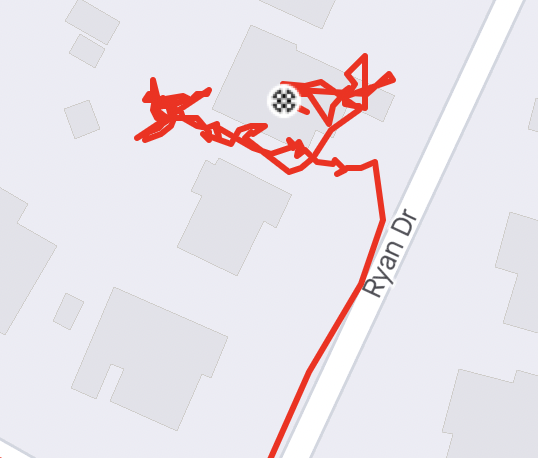

# everywhere

## Tools

```
node tools <command>
```

### Commands

#### `fetch-strava-trips`

```shell
node tools fetch-strava-trips       # fetch all trips
node tools fetch-strava-trips new   # stops fetching after the first trip that already exists
node tools fetch-strava-trips <id>  # fetch a single trip
```

#### `garmin-login`

Uses the [Garmin Connect Personal API](https://developer.garmin.com/gc-developer-program/personal/personal-api/). Create a key at https://connect.garmin.com/app/settings/personalApiToken and save it to `creds/garmin-api-key` (or run `garmin-login`, which prompts for it, or set `GARMIN_PERSONAL_API_KEY`). The key is exchanged for a 24 hour access token, cached in `creds/garmin.json`. Keys expire after the period you choose when creating them.

#### `fetch-garmin-activities`

```shell
node tools fetch-garmin-activities       # fetch all activities
node tools fetch-garmin-activities new   # stops fetching after the first activity that already exists
node tools fetch-garmin-activities <id>  # fetch a single activity
```

Saves `data/garmin-activities/<id>.json` (summary and details) and `<id>.zip` (the original file from the device).

#### `garmin-fit-info`

Summarizes a downloaded original file: connected sensors, Varia radar events, Connect IQ developer fields, and messages not in the public FIT profile. Pass `--json` to dump every decoded message. See [docs/garmin.md](docs/garmin.md) for what's in the files, especially the radar data.

```shell
node tools garmin-fit-info <id or .zip/.fit path>
```

#### `build-combined-strava-dataset`

Creates a single topojson file with all Strava trips. Pass `--geojson` to output a GeoJSON `FeatureCollection` instead.

```shell
node tools build-combined-strava-dataset > trips.json
node tools build-combined-strava-dataset --geojson > trips.geojson
```

#### `build-combined-video-dataset`

Creates a single topojson file with all videos.

#### `extract-video-metadata`

Extracts metadata from videos.

```shell
node tools extract-video-metadata <file or directory>
```

#### `list-s3-videos`

Display a list of videos in the S3 bucket.

#### `cloudflare`

Experimental. Load a video from S3 to Cloudflare Stream.

`find-junk-trip-data`

Finds strava trips that have many points very close together. This is often due to forgetting to stop the recording.



`encode-new-videos`

Using the Brightcove Zencoder API, encode videos that have been uploaded to S3 but not yet encoded.

`list-trips`

Logs every trip object available from Strava.

## Datasets

`everywhere-2015-v1`

The original dataset from riding every street in Somerville in 2015.
